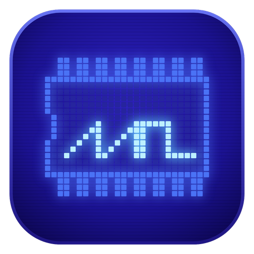
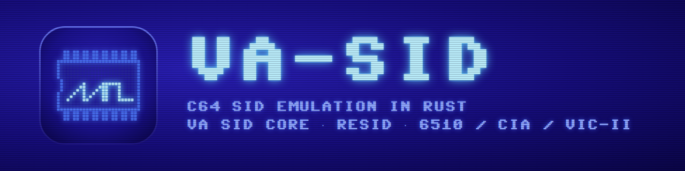

# va-sid

<p align="center">
  
</p>

<!-- badges:start -->
<p align="center">
  <a href="https://github.com/zstarczali/VA-SID/blob/main/Cargo.toml"></a>
  <a href="https://github.com/zstarczali/VA-SID/blob/main/LICENSE"></a>
  <a href="https://www.rust-lang.org/"></a>
  <a href="https://github.com/binaryfields/resid-rs"></a>
  <a href="https://vice-emu.sourceforge.io/"></a>
  <a href="https://www.c64va.pro/register/donate.php"></a>
</p>
<p align="center">
  <a href="https://github.com/zstarczali/VA-SID/commits/main"></a>
  <a href="https://github.com/zstarczali/VA-SID/graphs/commit-activity"></a>
  <a href="https://github.com/zstarczali/VA-SID/issues"></a>
  <a href="https://github.com/zstarczali/VA-SID/stargazers"></a>
</p>
<p align="center">
  <a href="https://www.c64va.pro/"></a>
  <a href="https://github.com/zstarczali/SID-Studio"></a>
</p>
<!-- badges:end -->

<p align="center">
  
</p>

The Commodore 64 SID emulation shared by [C64 Visual Assembler](https://www.c64va.pro/) and
[VA SID Studio](https://github.com/zstarczali/SID-Studio).

| Module | Contents |
|--------|----------|
| `sid_core` | VA SID Core: the Rust SID synthesizer, 6581 and 8580 (with the 8580 digi boost) |
| `sid_chip` | One SID chip on VA SID Core or reSID (`SidEngine`, `SidChip`) |
| `mos6510`, `c64` | Cycle-exact 6510, CIA 6526 / 6526A, VIC-II timing and the CPU port (VICE ports) |
| `sid_file` | A C64 running a .sid (PSID / RSID) tune: playback, seeking, register dump, 2SID / 3SID |
| `session` | The SID Editor preview renderer and the .sid playback sessions behind the apps' Tauri commands |

The crate does not depend on Tauri. The apps wrap the `session` functions in their own commands
(`render_sid_preview`, `release_sid_preview`, `render_sid_file`, `sid_file_info`, `sid_register_dump`,
`release_sid_file`) and run the blocking ones on `spawn_blocking`.

## Use

```toml
va-sid = { git = "https://github.com/zstarczali/VA-SID.git", rev = "<sha>" }
```

For local work on the crate and an app at the same time, in the app's `src-tauri/Cargo.toml`
(not to be committed):

```toml
[patch."https://github.com/zstarczali/VA-SID.git"]
va-sid = { path = "../../VA-SID" }
```

## Tests

```
cargo test
```

The ignored tests are manual checks on real tunes (`SID_SMOKE_DIR`, `SID_DUMP_IN` / `SID_DUMP_OUT`).
`samples/` holds the two tunes the tests play. `scripts/sid-reference` is the diagnostic comparison
of VA SID Core with VICE's mos6581_8580 (it predates the cycle-clocked core API and needs updating).

## Logo

`assets/logo.svg` is the source; `python assets/make_logo.py` renders `logo.png` and `banner.png`
(Pillow + Microsoft Edge). The banner uses the C64 Pro Mono font by Style.

## License

GPL-3.0-or-later (see [LICENSE](LICENSE)). It contains reSID by Dag Lem, Rust port by Sebastian
Jastrzebski (`vendor/resid-rs`, GPL-3.0-or-later, with one fix, see its `VENDORED.md`); ports of
VICE code in `src/mos6510.rs` and `src/c64/` (copyright the VICE Team, GPL-2.0-or-later); and in
`src/sid_core.rs` and `vendor/sid-wave-tables` code and data derived from Dag Lem's `mos6581_8580`
(GPL-2.0-or-later), as identified in the source.
